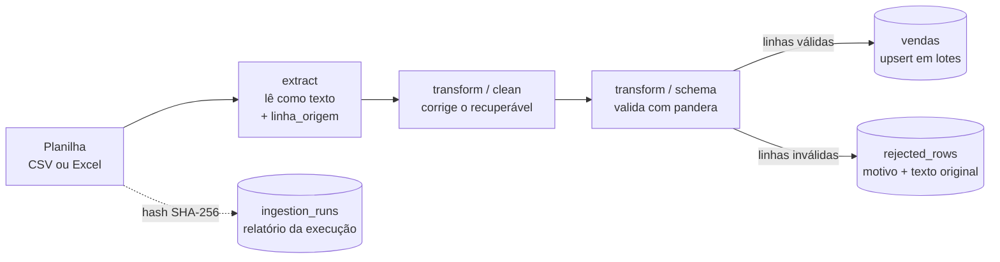

# ETL de Planilhas de Vendas

[](https://github.com/ThaisAlves7/etl-planilhas/actions/workflows/ci.yml)

Pipeline que lê planilhas de vendas **sujas** (CSV ou Excel), corrige o que dá para corrigir, **rejeita com motivo** o que não dá e carrega o resultado no PostgreSQL. Um comando roda tudo, e **reprocessar o mesmo arquivo não duplica linhas**.

## O que este projeto demonstra

- **Qualidade de dados:** limpeza das variações recuperáveis (datas, valores, nomes) e validação das regras do contrato com pandera. O que não passa vai para uma quarentena, com o motivo e o texto original da linha.
- **Idempotência:** o mesmo arquivo pode ser processado várias vezes sem duplicar dados, em duas camadas (hash do arquivo e upsert por chave natural).
- **Testes:** testes unitários e de integração contra um PostgreSQL real e isolado, incluindo um teste que compara os defeitos **injetados** com os **detectados**.

## Como funciona



Para cada arquivo, o `etl run`:

1. calcula o hash SHA-256 do conteúdo e, se o arquivo já foi processado com sucesso (e não há `--force`), encerra avisando;
2. registra a execução em `ingestion_runs` (`em_andamento`);
3. lê o arquivo (CSV ou Excel, escolhido pela extensão) **tudo como texto**, guardando a linha de origem de cada registro;
4. **limpa** o que é recuperável e converte os tipos;
5. **valida** cada linha; as inválidas vão para `rejected_rows`, com todos os motivos e o texto original;
6. carrega as válidas na `vendas` com upsert, em lotes, dentro de uma transação;
7. fecha a execução com os contadores (`sucesso`) ou registra a falha (`falha`) e repassa o erro.

### Idempotência em duas camadas

| Camada | Como funciona |
| --- | --- |
| **Arquivo** | Se já existe execução `sucesso` com o mesmo hash, o arquivo é ignorado (nenhuma execução nova é registrada). `--force` reprocessa. |
| **Linha** | `INSERT ... ON CONFLICT (numero_pedido) DO UPDATE`. Mesmo com `--force`, nada duplica: a última carga vence. |

## Começando

**Pré-requisito:** Docker Desktop. Nada de banco de dados instalado na máquina: tudo roda em containers.

```bash
# 1. sobe o PostgreSQL e constrói a imagem da aplicação
docker compose up -d db
docker compose build app

# 2. cria as tabelas
docker compose run --rm app etl init-db

# 3. processa uma planilha
docker compose run --rm app etl run data/sample/vendas_sujos.csv
```

O PostgreSQL também fica acessível pelo Windows/macOS/Linux em `localhost:5433` (usuário `etl`, senha `etl`, banco `vendas`), **somente para desenvolvimento**.

### Comandos

| Comando | O que faz |
| --- | --- |
| `etl init-db` | Cria as tabelas (seguro rodar mais de uma vez). |
| `etl run ARQUIVO` | Processa a planilha e mostra o resumo. |
| `etl run ARQUIVO --config OUTRO.yaml` | Usa outra configuração de fonte (padrão: `config/vendas.yaml`). |
| `etl run ARQUIVO --force` | Reprocessa mesmo que o arquivo já tenha sido processado. |
| `etl run planilha.xlsx --config config/vendas_excel.yaml` | Processa uma planilha Excel (a aba e as linhas de título vêm da configuração). |

Códigos de saída: `0` (sucesso ou arquivo ignorado), `1` (erro, já registrado como `falha` em `ingestion_runs`) e `2` (uso incorreto, como arquivo inexistente).

### Configuração da fonte

Cada fonte tem o seu YAML, validado com Pydantic (uma chave com erro de digitação é recusada, não ignorada).

`config/vendas.yaml` (CSV):

```yaml
encoding: latin-1
delimitador: ";"
# Formatos de data aceitos, tentados NA ORDEM. A ordem define a regra
# "dia primeiro" para datas ambíguas como 05/03/2026.
formatos_data:
  - "%Y-%m-%d"
  - "%d/%m/%Y"
  - "%d/%m/%y"
  - "%Y/%m/%d"
```

`config/vendas_excel.yaml` (Excel):

```yaml
nome_aba: Vendas
linhas_antes_do_cabecalho: 2
formatos_data:
  - "%Y-%m-%d"
  - "%Y-%m-%d %H:%M:%S"   # data de célula do Excel (a hora vem zerada)
  - "%d/%m/%Y"
  - "%d/%m/%y"
  - "%Y/%m/%d"
```

O Excel guarda a data como data, e não como texto: ela chega ao pipeline como `2026-01-10 00:00:00`, por isso o formato extra.

## Demonstração

Saída real, com o banco zerado (`docker compose down -v`, `docker compose up -d db`, `etl init-db`).

**Arquivo com defeitos recuperáveis** (datas, valores e nomes bagunçados):

```text
$ etl run data/sample/vendas_sujos.csv
200 lidas, 200 válidas, 0 rejeitadas, 200 inseridas, 0 atualizadas

$ etl run data/sample/vendas_sujos.csv
Arquivo já processado. Use --force para reprocessar.

$ etl run data/sample/vendas_sujos.csv --force
200 lidas, 200 válidas, 0 rejeitadas, 0 inseridas, 200 atualizadas
```

```sql
SELECT count(*) FROM vendas;   -- 200, depois de três execuções
```

**Arquivo com defeitos que não têm conserto** (e-mail inválido, quantidade zero, total inconsistente, campo obrigatório vazio). Em um banco zerado:

```text
$ etl run data/sample/vendas_com_erros.csv
200 lidas, 176 válidas, 24 rejeitadas, 176 inseridas, 0 atualizadas
```

```sql
SELECT motivo_rejeicao, count(*) FROM rejected_rows GROUP BY 1 ORDER BY 1;
```

```text
      motivo_rejeicao      | count
---------------------------+-------
 campo_obrigatorio_ausente |     6
 email_invalido            |     6
 quantidade_invalida       |     6
 total_inconsistente       |     6
```

A quarentena guarda a linha como ela chegou, o que permite achar o problema na planilha:

```sql
SELECT linha_origem, motivo_rejeicao, payload
FROM rejected_rows
ORDER BY linha_origem;
```

**Planilha Excel** (duas linhas de título acima do cabeçalho, datas como células e uma aba extra sem dados úteis):

```bash
docker compose run --rm app etl run data/sample/vendas_sujos.xlsx --config config/vendas_excel.yaml
```

Os mesmos 200 pedidos em Excel dão o mesmo resultado que em CSV: um teste de integração compara as linhas gravadas nos dois casos.

Em um banco zerado, a saída é:

```text
200 lidas, 200 válidas, 0 rejeitadas, 200 inseridas, 0 atualizadas
```

Rodada depois do `vendas_com_erros.csv` no mesmo banco, ela vira `200 lidas, 200 válidas, 0 rejeitadas, 24 inseridas, 176 atualizadas`: os 176 pedidos que já existiam são atualizados e os 24 que aquele arquivo havia rejeitado são inseridos. Nenhuma linha duplica.

## Regras de qualidade

### Limpeza (o que é corrigido)

| Problema | Tratamento |
| --- | --- |
| Campo vazio ou só com espaços | vira nulo (e é rejeitado se o campo for obrigatório) |
| Datas em formatos diferentes | convertidas com os formatos da configuração, na ordem |
| Valores como `R$ 1.234,50`, `1234,50` ou `1234.50` | convertidos para decimal com 2 casas |
| Nomes em maiúsculas, minúsculas ou com espaços sobrando | normalizados (`Maria Silva`) |
| Quantidade como texto | convertida para inteiro; o que não for inteiro vira nulo |
| Datas de célula do Excel (`2026-01-10 00:00:00`) | aceitas pelo formato `%Y-%m-%d %H:%M:%S` da configuração do Excel |

Quando um valor não pode ser convertido, a limpeza devolve **nulo** em vez de inventar um número. A linha é rejeitada na validação, e o texto original continua guardado.

### Validação (o que é rejeitado)

| Campo | Regra | Motivo registrado |
| --- | --- | --- |
| `numero_pedido` | obrigatório | `campo_obrigatorio_ausente` |
| `numero_pedido` | único no arquivo (as duas ocorrências são rejeitadas) | `numero_pedido_repetido` |
| `data_pedido` | obrigatória e não pode ser futura | `data_futura` |
| `cliente_nome` | obrigatório | `campo_obrigatorio_ausente` |
| `cliente_email` | obrigatório e com formato válido | `email_invalido` |
| `produto` | obrigatório | `campo_obrigatorio_ausente` |
| `quantidade` | inteiro maior que 0 | `quantidade_invalida` |
| `valor_unitario` | obrigatório e maior que 0 | `valor_unitario_invalido` |
| `valor_total` | igual a `quantidade × valor_unitario` | `total_inconsistente` |

Uma linha pode ter mais de um problema: cada motivo vira uma linha em `rejected_rows`.

## Modelo de dados

| Tabela | Para quê | Colunas principais |
| --- | --- | --- |
| `vendas` | dados carregados | `numero_pedido` (chave), `data_pedido`, `cliente_nome`, `cliente_email`, `produto`, `quantidade`, `valor_unitario` e `valor_total` (`NUMERIC(10,2)`). O banco repete as regras como restrições (`quantidade > 0`, `valor_unitario > 0`). |
| `ingestion_runs` | uma linha por execução | `nome_arquivo`, `arquivo_hash`, `status` (`em_andamento`, `sucesso` ou `falha`), contadores (`linhas_lidas`, `linhas_validas`, `linhas_rejeitadas`, `linhas_inseridas`, `linhas_atualizadas`), `mensagem_erro`, `iniciado_em` e `finalizado_em` |
| `rejected_rows` | quarentena | `run_id`, `linha_origem`, `numero_pedido` (pode ser nulo), `motivo_rejeicao`, `payload` (JSONB com a linha original, como texto) |

## Testes

```bash
docker compose run --rm app pytest -q
```

- `tests/unit/`: funções puras de limpeza, schema, configuração, leitura e hash, sem banco.
- `tests/integration/`: carga, execuções, quarentena, pipeline completo e CLI, contra um **PostgreSQL real**. Um banco separado (`vendas_test`) é criado automaticamente pela fixture em `tests/conftest.py` e esvaziado a cada teste, então o banco de desenvolvimento nunca é tocado.

Alguns testes que dão confiança ao projeto:

- **Idempotência:** carregar o mesmo arquivo duas vezes mantém a contagem; com `--force`, as linhas são atualizadas, não duplicadas.
- **Injetado vs. detectado:** o gerador estraga linhas de propósito e anota quais; o teste exige que a quarentena contenha **exatamente** esses pares (pedido, motivo).
- **Falha registrada:** um arquivo quebrado deixa a execução como `falha` (nunca pendurada) e o erro chega a quem chamou.
- **Limites reais:** carga de 10.000 linhas (o driver limita os parâmetros por comando, por isso a carga é em lotes) e recusa de `numero_pedido` repetido.
- **CSV e Excel equivalentes:** os mesmos pedidos nos dois formatos resultam nas mesmas linhas no banco.

O CI (GitHub Actions) roda `ruff` e `pytest` com um serviço PostgreSQL a cada push, e o Dependabot propõe as atualizações de dependências e das actions.

## Dados de exemplo

O gerador (`scripts/gerar_dados_faker.py`) usa Faker com sementes fixas, então os arquivos são reproduzíveis:

```bash
docker compose run --rm app python scripts/gerar_dados_faker.py
```

| Arquivo (`data/sample/`) | Conteúdo |
| --- | --- |
| `vendas_limpos.csv` | 200 pedidos válidos (o gabarito) |
| `vendas_sujos.csv` | os mesmos pedidos com defeitos **recuperáveis**: datas em formatos mistos (5%), valores com `R$`/vírgula (10%) e nomes bagunçados (15%) |
| `vendas_com_erros.csv` | defeitos recuperáveis **e** defeitos sem conserto: e-mail inválido, quantidade zero, total inconsistente e campo obrigatório vazio (3% de cada) |
| `vendas_sujos.xlsx` | os mesmos pedidos de `vendas_sujos.csv` em Excel: duas linhas de título acima do cabeçalho, datas como células de data e uma aba extra sem dados úteis (use `--config config/vendas_excel.yaml`) |
| `rejeicoes_esperadas.csv` | o gabarito dos defeitos sem conserto: pedido e motivo esperado |

Cada linha recebe no máximo um defeito de cada grupo, e os defeitos sem conserto violam uma regra só, para o gabarito ser exato.

## Estrutura do repositório

```text
.
├── .github/
│   ├── workflows/ci.yml         # ruff + pytest
│   └── dependabot.yml           # atualização das actions
├── config/
│   ├── vendas.yaml              # configuração da fonte (CSV)
│   └── vendas_excel.yaml        # configuração da fonte (Excel)
├── data/sample/                 # planilhas de exemplo
├── scripts/gerar_dados_faker.py # gerador de dados sujos
├── src/etl/
│   ├── cli.py                   # comandos etl init-db / etl run
│   ├── config.py                # modelo e leitura da configuração
│   ├── pipeline.py              # liga todas as camadas
│   ├── extract/                 # leitura do arquivo e hash
│   ├── transform/               # clean.py e schema.py (pandera)
│   └── load/                    # tabelas, upsert, execuções e quarentena
├── tests/
│   ├── conftest.py              # banco de testes isolado
│   ├── unit/
│   └── integration/
├── docker-compose.yml
├── Dockerfile
└── pyproject.toml
```

## Decisões de projeto

- **Quarentena em vez de descarte.** Linha inválida nunca some: vai para `rejected_rows` com `linha_origem`, motivo e o texto original.
- **Limpar é diferente de validar.** A limpeza corrige o que tem conserto e devolve nulo quando não tem; o schema rejeita. Ausência nunca vira zero: preencher um valor faltando é decisão de negócio, não do pipeline.
- **Tudo é lido como texto.** A conversão de tipos acontece na limpeza, onde cada erro pode ser tratado. Isso evita que o pandas "adivinhe" tipos.
- **Datas ambíguas.** `05/03/2026` pode ser 5 de março ou 3 de maio, e nenhum código descobre olhando só o valor. A regra vem da configuração (a ordem dos formatos), e o formato americano ficou fora dos dados de exemplo.
- **`NUMERIC` para dinheiro**, porque o ponto flutuante não representa decimais exatamente.
- **Execução registrada em transação própria.** Se a carga falhar e desfizer tudo, o registro de que ela falhou (e por quê) permanece. A idempotência torna isso seguro: se o programa cair no meio, a execução fica `em_andamento` e a próxima a reprocessa sem duplicar nada.
- **Carga atômica e em lotes.** O arquivo inteiro é uma transação (tudo ou nada); os lotes (1.000 linhas) respeitam o limite de parâmetros por comando do driver.
- **Configuração validada.** Chave desconhecida no YAML é erro, para um `encodng` digitado errado não ser ignorado em silêncio.
- **Excel como fonte configurável.** A aba e o número de linhas de título vêm da configuração, e a `linha_origem` conta essas linhas, para o analista achar o registro na planilha.
- **Versões controladas.** O `ruff` tem versão exata (as regras padrão dele mudaram entre versões e derrubaram o CI de uma hora para outra) e as bibliotecas de execução são limitadas à série testada (`~=`), para uma versão nova não quebrar o projeto sem aviso.
- **Mensagens de erro curtas.** O texto do erro registrado em `ingestion_runs` é cortado: as mensagens do driver incluem os parâmetros da consulta, que contêm dados pessoais.

## Limitações conhecidas

- A carga só faz **upsert**: uma linha removida da planilha não é apagada do banco.
- `atualizadas` conta as linhas que já existiam no banco, mesmo que os dados sejam idênticos aos da carga anterior (o upsert reescreve a linha).
- Se o mesmo `numero_pedido` chega com dados diferentes, **a última carga vence**.
- Valores sem vírgula (`1234.50`) são lidos como decimais com ponto; `1.234` sem vírgula seria lido como 1,23.
- Partículas de nomes (`da`, `de`) também recebem inicial maiúscula (`Maria Da Silva`).
- Interromper o programa com Ctrl+C deixa a execução como `em_andamento`; reexecutar o arquivo é seguro.
- Execuções ignoradas (arquivo já processado) não deixam registro.
- As rejeições de uma execução que falhou continuam no banco, ligadas a uma execução com `status = 'falha'`: ao analisar a quarentena, filtre por `ingestion_runs.status = 'sucesso'`.
- O esquema é criado com `create_all`, sem sistema de migrações.
- Em planilhas Excel, só a aba configurada é lida: um arquivo com várias abas de dados exige uma execução por aba.

## Próximos passos

- [ ] Logs estruturados por etapa, com o `run_id`.
- [ ] Migrações com Alembic.
- [ ] Carga em modo streaming para arquivos muito grandes.

## Tecnologias

Python 3.12 · PostgreSQL 16 · pandas · openpyxl · pandera · Pydantic · SQLAlchemy 2 · psycopg 3 · Typer · pytest · Faker · ruff · Docker Compose · GitHub Actions
